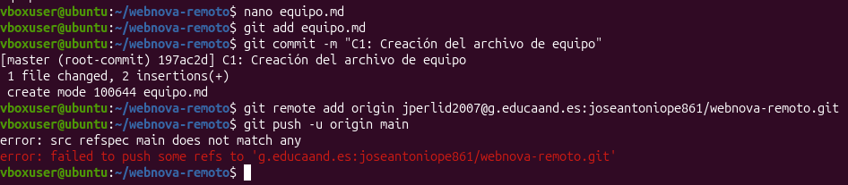
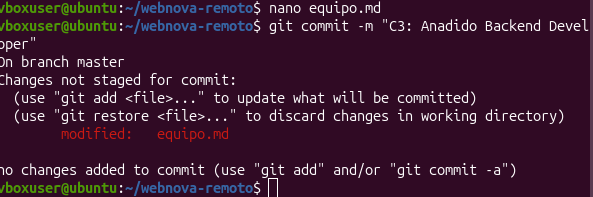
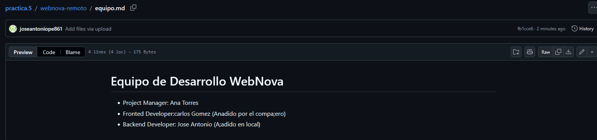

# Práctica 5. Colaboración en GitHub y Resolución de Conflictos Remotos - Entregable

---

## 1. Captura 1: Error `! [rejected]` al hacer `git push`

En la Fase 3, al intentar subir nuestros cambios locales sin habernos sincronizado previamente con el repositorio remoto, Git rechaza la operación para evitar sobrescribir el trabajo del compañero.

---

## 2. Captura 2: Marcas de Conflicto en el Editor de Código

Durante el proceso de `git pull --rebase`, Git detecta que la misma línea ha sido modificada tanto en el servidor como localmente, deteniendo el proceso y mostrando las marcas de conflicto (`<<<<<<<`, `=======`, `>>>>>>>`).

---

## 3. Captura 3: Repositorio en GitHub con el Resultado Final

Una vez aplicado `git add`, `git rebase --continue` y el `git push` definitivo, el archivo en la interfaz web de GitHub muestra la integración completa y correcta de ambos miembros.

---

## 4. Pregunta de Reflexión

### ¿Por qué Git bloqueó tu subida en la Fase 3?
Git bloqueó la subida (`push`) porque el repositorio remoto (`origin/main`) se encontraba en un estado más avanzado respecto al commit local desde el cual partímos. 

### ¿Qué ventaja tiene usar `git pull --rebase` en lugar de un simple `git pull` en estos casos?
* Un `git pull` normal crearía un commit de fusión (*merge commit*) adicional y una rama innecesaria en el grafico de commits para unir las dos historias.
* En cambio, `git rebase` toma nuestros commits locales pendientes, "pausa" temporalmente nuestro trabajo, descarga los nuevos commits del repositorio remoto y vuelve a aplicar nuestros commits locales **por encima** de los del compañero. 
